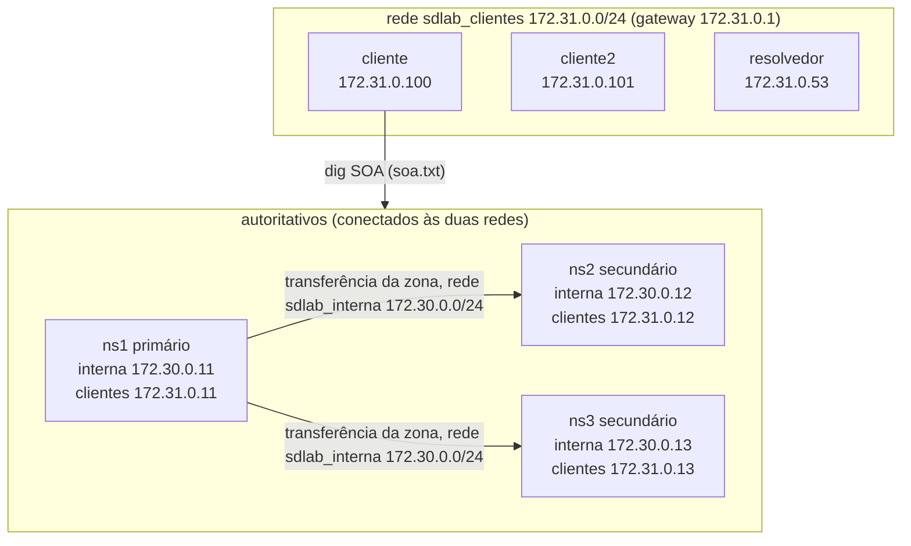

# Topologia do laboratório

Diagrama da topologia observada no E1 (`experimentos/E1/redes.json` e `experimentos/E1/soa.txt`). Usa só nomes e endereços que aparecem nesses arquivos. Cada autoritativo participa das duas redes.

- `sdlab_interna` (172.30.0.0/24, gateway 172.30.0.1) tem só ns1, ns2 e ns3.
- `sdlab_clientes` (172.31.0.0/24, gateway 172.31.0.1) tem os três autoritativos, o resolvedor, o cliente e o cliente2.
- O resolvedor, o cliente e o cliente2 não estão na rede interna.
