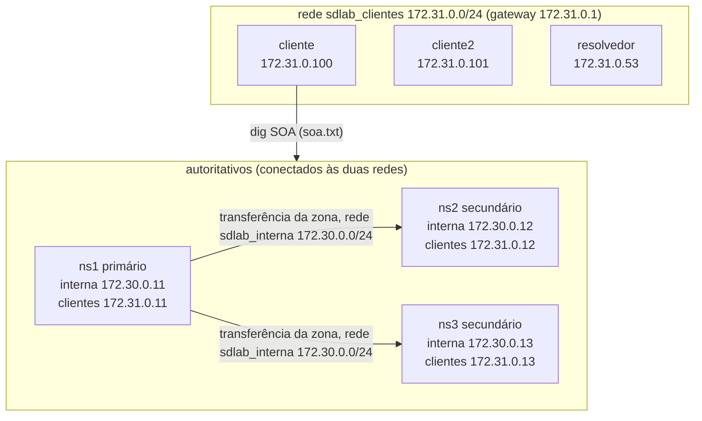

# Procedimento executado: E1 (Subida e topologia)

- Responsável: João Balhego
- Execução: João Balhego, no próprio terminal (WSL2). A redação deste procedimento e da análise foi feita com apoio do assistente de IA Claude, a partir das evidências desta pasta.
- Revisão: Taryck Gean (nota sobre a flag `aa`, em Limitações)
- Data/hora: 27/10/2026, `reset.sh` iniciado às 19:24:44 (UTC-3). Os logs do BIND estão em UTC (22:24 = 19:24 local).
- Máquina (ver `docs/ambiente/joao-windows.md`): WSL2 (Ubuntu 26.04), Docker 29.9.2, Compose v5.6.1, BIND 9.18.49
- Commit/tag: laboratório `8c48e53`; previsão `ea9d14f` (commit das 19:15:35, anterior à execução)
- Variante (COMPOSE_FILE): base (`unset COMPOSE_FILE` antes de começar)

## Condição inicial

- O laboratório de execuções anteriores (E3 e E4) ainda estava no ar. A saída do `reset.sh` mostra os seis contêineres e as duas redes sendo parados e removidos antes da recriação.
- `scripts/verificar.sh` **não** foi rodado antes deste experimento.
- A previsão (`previsao.md`) foi commitada antes de qualquer comando de execução (19:15:35, contra 19:24:44 do reset).

## Passos e comandos

1. Subida do ambiente do zero:
   `{ date '+%d/%m/%Y %H:%M:%S'; scripts/reset.sh; } 2>&1 | tee experimentos/E1/saida-reset.txt`
2. Status dos contêineres:
   `docker compose ps 2>&1 | tee experimentos/E1/compose-ps.txt`
3. Transferência inicial nos secundários (comando do roteiro, com ns2 e ns3):
   `docker compose logs ns2 ns3 | grep -i transfer | tee experimentos/E1/logs-transferencia.txt`
4. SOA nos três autoritativos, consultado de dentro do contêiner `cliente`:
   `for s in 11 12 13; do echo "@172.31.0.$s"; docker exec cliente dig @172.31.0.$s sd.lab SOA +short; done 2>&1 | tee experimentos/E1/soa.txt`
5. Redes Docker, para o diagrama:
   `docker network inspect sdlab_interna sdlab_clientes 2>&1 | tee experimentos/E1/redes.json`
6. Logs completos, com timestamp, de todos os contêineres:
   `scripts/salvar-logs.sh experimentos/E1 subida`

## Evidências geradas (arquivos nesta pasta)

| Arquivo | O que mostra |
|---|---|
| `previsao.md` | Previsão (commit `ea9d14f`), não alterada |
| `saida-reset.txt` | Saída do `reset.sh`, terminando em `Convergência: serial 2026101401 em ns1, ns2 e ns3.` |
| `compose-ps.txt` | Seis serviços em execução, imagem `sd-bind`, coluna de portas vazia |
| `logs-transferencia.txt` | Linhas com "transfer" nos logs de ns2 e ns3 |
| `soa.txt` | SOA nos três autoritativos |
| `redes.json` | Sub-redes, gateways e endereço de cada contêiner nas duas redes |
| `20261027-192655-subida.txt` | Logs completos (54 KB) de todos os contêineres |

## Observações durante a execução

- O `reset.sh` terminou sem o aviso `AVISO: sem convergência em 60s`.
- As redes foram criadas às 22:24:49,285 (`redes.json`, campo `Created`). As transferências iniciais foram às 22:24:50,977 (ns2) e 22:24:51,089 (ns3), ou seja, cerca de 1,7 s depois da criação das redes.
- No log completo, **ns2 e ns3 registraram `refresh: failure trying primary 172.30.0.11#53 ... connection refused`, ambos às 22:24:50,477**, antes da transferência. O ns2 transferiu 0,500 s depois dessa falha e o ns3 0,612 s depois. Esse padrão não estava na previsão.
- Nenhum dos comandos do E1 consultou o resolvedor (só os autoritativos foram consultados diretamente), e o `verificar.sh` não foi rodado. Isso mantém o cache do resolvedor vazio para o E2, o que a primeira consulta do E2 confirma (TTL 60 e consulta chegando ao ns1).

## Restauração

Nenhuma. O ambiente-base ficou no ar e o E2 foi executado em seguida, sem outro reset.

---

# Análise: previsão × resultado

## Itens previstos

| Item da previsão | Previsto | Observado | Resultado |
|---|---|---|---|
| `reset.sh` | Termina com convergência do serial 2026101401 | `Convergência: serial 2026101401 em ns1, ns2 e ns3.`, sem aviso | Confirmado |
| `docker compose ps` | 6 serviços, imagem `sd-bind`, portas vazias | 6 serviços (`cliente`, `cliente2`, `ns1`, `ns2`, `ns3`, `resolvedor`), todos `sd-bind`, portas vazias | Confirmado |
| Logs de transferência | 5 linhas por secundário, vindas de `172.30.0.11`, na ordem prevista | 5 linhas em cada um (10 no total), na ordem prevista, todas de `172.30.0.11#53` | Confirmado |
| Dados da transferência | 9 registros, serial 2026101401 | `Transfer completed: 1 messages, 9 records, 224 bytes, 0.001 secs ... (serial 2026101401)` nos dois | Confirmado |
| Tipo da transferência | Completa (AXFR, não IXFR) | O log do ns1 registra `transfer of 'sd.lab/IN': AXFR started (serial 2026101401)` para `172.30.0.12` (22:24:50,977) e para `172.30.0.13` (22:24:51,089), cada uma seguida de `AXFR ended: 1 messages, 9 records, 224 bytes` | Confirmado |
| SOA nos três | Três linhas idênticas `... 2026101401 30 10 300 20` | Três linhas idênticas, exatamente esse valor | Confirmado |
| Redes e endereços | Tabela prevista | Todos os endereços da tabela aparecem em `redes.json` | Confirmado |
| Falha de refresh no filtro `transfer` | Linhas de falha, se existirem, não entram no filtro | Existem no log completo e não aparecem no arquivo filtrado | Confirmado |

Pelo critério "O que invalidaria a previsão", nenhuma das cinco condições ocorreu: seriais iguais, 6 contêineres sem portas publicadas, transferência vinda de `172.30.0.11`, transferência bem-sucedida em ambos e 9 registros.

## Tempo até a convergência

A previsão dava ~1 s para o ns3 e algo entre ~1 s e ~60 s para o ns2, com o risco de o `reset.sh` imprimir o aviso de 60 s.

- Observado: ns2 às 22:24:50,977 e ns3 às 22:24:51,089, ~1,7 s depois da criação das redes. O aviso não apareceu.
- O resultado fica **dentro da faixa prevista**, perto do limite inferior. O atraso de ~58 s do ns2 visto na execução do E4 **não se repetiu**. Com uma observação de cada, a causa dos ~58 s do E4 continua **não determinada**.

## O que a previsão não antecipou

**Falha de refresh no boot nos dois secundários.** Às 22:24:50,477, ns2 e ns3 registram `connection refused` ao tentar o primário `172.30.0.11`. Em seguida a transferência acontece em 0,5 a 0,6 s. O que o log mostra é isso; o resto é **hipótese não verificada**:

- A falha provavelmente vem de o ns1 ainda não estar atendendo quando os secundários fizeram a primeira consulta, já que os contêineres sobem ao mesmo tempo. Não verificado.
- O que disparou a transferência 0,5 s depois (nova tentativa de refresh, ou NOTIFY do ns1 ao subir) não foi verificado nesta análise.
- No E4, a falha do ns2 foi seguida de ~58 s de espera. Aqui, a mesma mensagem foi seguida de ~0,5 s. A diferença **não foi explicada**.

## Topologia observada

O diagrama usa só nomes e endereços que aparecem em `redes.json` e `soa.txt`. Cada autoritativo participa das duas redes.

- `sdlab_interna` (172.30.0.0/24, gateway 172.30.0.1) tem só ns1, ns2 e ns3.
- `sdlab_clientes` (172.31.0.0/24, gateway 172.31.0.1) tem os três autoritativos, o resolvedor, o cliente e o cliente2.
- O resolvedor, o cliente e o cliente2 **não** estão na rede interna. A conexão do resolvedor com os autoritativos não foi exercitada neste experimento (ver E2).

## Papéis dos nós

- **ns1 (primário):** os secundários buscam a zona nele (`from 172.30.0.11#53` nos logs).
- **ns2 e ns3 (secundários):** receberam a zona por transferência e respondem com o mesmo serial.
- **resolvedor, cliente e cliente2:** presentes só na rede de clientes. Os papéis de cache e de cliente de teste vêm da configuração do kit e não foram exercitados no E1.

## Conclusão do E1

O ambiente sobe do zero com seis contêineres. Os dois secundários obtêm a zona do primário pela rede interna e ficam com o mesmo serial (2026101401). A previsão foi confirmada em todos os itens, exceto pela falha de refresh de boot (`connection refused`) nos dois secundários, que a previsão não esperava, e cuja causa e recuperação em ~0,5 s ficam como hipótese.

## Limitações

- Uma única execução do `reset.sh`.
- O arquivo `logs-transferencia.txt` (filtro do roteiro) mostra só o lado dos secundários. O tipo AXFR e os endereços de origem das transferências vêm do log completo do ns1 (`20261027-192655-subida.txt`, linhas 328 a 331).
- Os logs completos foram lidos por `grep` de padrões específicos, não linha a linha.
- O `soa.txt` usa `+short` e não mostra a flag `aa`. A resposta com autoridade dos três autoritativos aparece na validação do ambiente feita antes, na mesma máquina (`docs/ambiente/validacao-inicial-joao-windows.txt`: `SOA em 172.31.0.11`, `172.31.0.12` e `172.31.0.13`, serial 2026101401, `flag aa`) e, para o ns1, no E2 (`consultas-dig.txt`: `flags: qr aa`).
- O diagrama retrata o estado desta execução. A configuração dos arquivos do kit não faz parte das evidências do E1.
