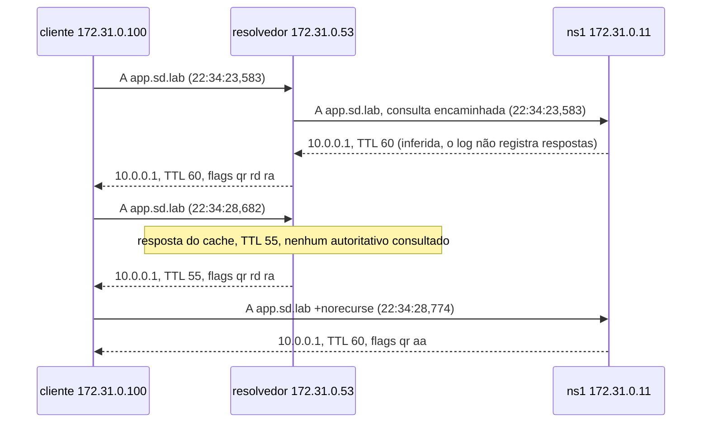
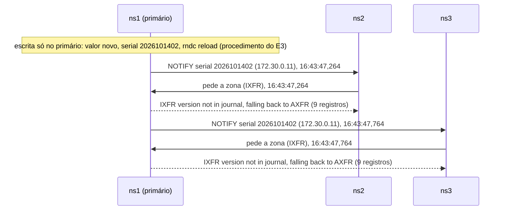

# Procedimento executado: E2 (Caminho de uma operação)

- Responsável: João Balhego
- Execução: João Balhego, no próprio terminal (WSL2). A redação deste procedimento e da análise foi feita com apoio do assistente de IA Claude, a partir das evidências desta pasta e da do E3.
- Data/hora: 27/10/2026, `T0` = 22:33:02 UTC (19:33:02 local); consultas de 19:34:23 a 19:34:28 (UTC-3). Os logs do BIND estão em UTC.
- Máquina (ver `docs/ambiente/joao-windows.md`): WSL2 (Ubuntu 26.04), Docker 29.9.2, Compose v5.6.1, BIND 9.18.49
- Commit/tag: laboratório `8c48e53`; previsão `ea9d14f` (commit das 19:15:35, anterior à execução)
- Variante (COMPOSE_FILE): base

## Condição inicial

- Logo depois do E1, no mesmo ambiente, **sem novo reset** e sem rodar `scripts/verificar.sh`. Nenhum comando do E1 consultou o resolvedor.
- Zona no estado inicial: `app.sd.lab` = 10.0.0.1, serial 2026101401, TTL 60.
- Cache do resolvedor presumido vazio. A primeira resposta (TTL 60, consulta chegando ao ns1) é a evidência disso.

## Passos e comandos

1. Marca de tempo e log de consultas ligado nos quatro servidores (o log é ligado **antes** das consultas, para a consulta encaminhada aparecer num autoritativo):
   `T0=$(date -u +%Y-%m-%dT%H:%M:%SZ); echo "T0=$T0" | tee experimentos/E2/t0.txt`
   `for s in resolvedor ns1 ns2 ns3; do echo "== $s"; docker exec $s rndc querylog on; done 2>&1 | tee experimentos/E2/querylog-on.txt`
2. Conferência de que o log está ligado:
   `for s in resolvedor ns1 ns2 ns3; do echo "== $s"; docker exec $s rndc status | grep -i "query logging"; done 2>&1 | tee experimentos/E2/querylog-status.txt`
3. Três consultas num bloco só, a partir do contêiner `cliente`: (1) `dig @172.31.0.53 app.sd.lab` (resolvedor, cache vazio); (2) a mesma consulta 5 s depois (`sleep 5`); (3) `dig @172.31.0.11 app.sd.lab +norecurse` (direto ao ns1). Saída em `experimentos/E2/consultas-dig.txt`.
4. Logs de cada servidor desde `T0`:
   `for s in resolvedor ns1 ns2 ns3; do echo "===== docker logs $s (desde $T0)"; docker logs --timestamps --since "$T0" $s 2>&1; done | tee experimentos/E2/logs-querylog.txt`
5. Log de consultas desligado e conferido:
   `for s in resolvedor ns1 ns2 ns3; do echo "== $s"; docker exec $s rndc querylog off; done 2>&1 | tee experimentos/E2/querylog-off.txt`
   (o mesmo arquivo recebe, em seguida, a conferência com `rndc status`)

A segunda consulta pelo resolvedor **não estava no roteiro**. Foi acrescentada para ter evidência do cache e do TTL decrescente.

## Evidências geradas (arquivos nesta pasta)

| Arquivo | O que mostra |
|---|---|
| `previsao.md` | Previsão (commit `ea9d14f`), não alterada |
| `t0.txt` | Instante inicial usado como filtro dos logs (22:33:02 UTC) |
| `querylog-on.txt`, `querylog-status.txt` | Ligar o log de consultas e a conferência `query logging is ON` nos 4 servidores |
| `consultas-dig.txt` | Saída completa dos três `dig` |
| `logs-querylog.txt` | Logs do resolvedor, ns1, ns2 e ns3 desde `T0`, com timestamp |
| `querylog-off.txt` | Desligar o log e a conferência `query logging is OFF` nos 4 servidores |

## Observações durante a execução

- O `rndc querylog on` e o `off` **não imprimem nada na tela**. A previsão esperava a mensagem na saída do comando. A mensagem existe, mas no log do servidor: `received control channel command 'querylog on'` e `query logging is now on`, em cada um dos quatro, entre 22:33:08,8 e 22:33:09,1. O estado foi confirmado com `rndc status` (ON antes, OFF depois).
- O log foi coletado antes do `querylog off`, então a mensagem de desligamento não aparece em `logs-querylog.txt`.
- O log do ns1 contém muitas linhas de consulta `sd.lab IN SOA` vindas de `172.30.0.12` e `172.30.0.13`. A previsão não as mencionava (ver análise).

## Restauração

`rndc querylog off` nos quatro servidores (feito e conferido). Nenhuma alteração de zona foi feita. O cache do resolvedor tem `app.sd.lab` com TTL 60 e expira sozinho.

---

# Análise: previsão × resultado

## Respostas `dig`

| Consulta | Previsto | Observado | Resultado |
|---|---|---|---|
| 1) resolvedor, cache vazio | NOERROR, `qr rd ra`, sem `aa`, `60 IN A 10.0.0.1` | NOERROR, flags `qr rd ra`, `app.sd.lab. 60 IN A 10.0.0.1`, 4 ms | Confirmado |
| 2) resolvedor, 5 s depois | Mesmas flags e valor, TTL ≈ 60 − N | `qr rd ra`, TTL **55**, 0 ms | Confirmado |
| 3) ns1 com `+norecurse` | `qr aa`, sem `rd` e sem `ra`, TTL 60 | Flags `qr aa`, TTL 60, 0 ms | Confirmado |

Detalhe não previsto: a resposta direta do ns1 traz também 3 registros NS na seção AUTHORITY e 3 A na ADDITIONAL (`MSG SIZE` 185, contra 83 nas respostas do resolvedor). Não foi interpretado.

## Log de consultas: por onde passou cada consulta

Linhas de consulta de `app.sd.lab` em `logs-querylog.txt` (hora UTC de 27/10/2026):

| Servidor | Hora | Origem | Corresponde a |
|---|---|---|---|
| resolvedor | 22:34:23,583 | `172.31.0.100` (cliente) | consulta 1 |
| ns1 | 22:34:23,583 | `172.31.0.53` (resolvedor), `+E(0)DCK` | consulta 1, encaminhada |
| resolvedor | 22:34:28,682 | `172.31.0.100` (cliente) | consulta 2 |
| ns1 | 22:34:28,774 | `172.31.0.100` (cliente), `-E(0)K` | consulta 3, direta, sem recursão |
| ns2, ns3 | (nenhuma) | — | — |

| Item da previsão | Resultado |
|---|---|
| Log do resolvedor com a consulta vinda de `172.31.0.100` | **Confirmado** (2 linhas, uma por consulta) |
| Um autoritativo recebe a consulta encaminhada do resolvedor (`172.31.0.53`) | **Confirmado**: foi o **ns1** |
| Os outros dois autoritativos não registram a consulta | **Confirmado** (ns2 e ns3 sem nenhuma linha de `app.sd.lab`) |
| Qual autoritativo é escolhido | Não previsto. Observado: ns1, em **uma** execução |
| Na consulta repetida, nenhum autoritativo registra nova consulta do resolvedor | **Confirmado**: depois de 22:34:23,583 não há consulta vinda de `172.31.0.53` |
| Consulta direta registrada só no ns1, vinda de `172.31.0.100` | **Confirmado** |
| `rndc querylog on` responde `query logging is now on` | **Diferente**: o `rndc` não imprime nada; a mensagem aparece no log do servidor |
| `rndc querylog off` responde `query logging is now off` | **Diferente**: sem saída; o estado OFF foi confirmado por `rndc status` |

Pelo critério "O que invalidaria a previsão", nenhuma condição ocorreu: o resolvedor respondeu sem `aa` e com `ra`; o ns1 respondeu com `aa` e sem `ra`; a primeira consulta veio com TTL 60; a repetida veio com TTL menor e sem nova consulta aos autoritativos; exatamente um autoritativo registrou a consulta encaminhada; e o log de consultas apareceu no `docker logs`.

Observação sobre a escolha do ns1: a previsão deixou aberto qual autoritativo seria escolhido, com a hipótese (não verificada) de o BIND escolher pelo tempo de resposta medido. **Uma observação não permite concluir o critério**; a hipótese continua não verificada.

## O que a previsão não antecipou: consultas de SOA no ns1

O log do ns1 tem 15 linhas `sd.lab IN SOA` no período (7 de `172.30.0.12`, 8 de `172.30.0.13`), além das 2 de `app.sd.lab`. Elas chegam pela rede interna e **não pertencem ao caminho da consulta de `app.sd.lab`**. A previsão de contagem ("1 linha em um autoritativo") só vale se restrita a `app.sd.lab`.

- Os intervalos entre linhas consecutivas do mesmo secundário vão de **24,0 a 29,0 s** (13 intervalos, todos ≤ 30 s).
- Leitura provável, **hipótese não verificada**: são as verificações periódicas de SOA dos secundários, ligadas ao `refresh` de 30 s da zona. É o mesmo mecanismo que a análise do E3 apontou para a propagação sem NOTIFY, mas aqui o log não diz o motivo das consultas.
- Que os intervalos fiquem entre 24 e 29 s e nunca acima de 30 s é compatível com algum jitter no timer. Isso **não foi verificado** no código ou na documentação do BIND.

## Quem guarda estado e quem tem autoridade

| Componente | O que se observou | Observado ou previsto? |
|---|---|---|
| resolvedor | Respondeu a consulta 2 com TTL 55 e sem nova consulta aos autoritativos: guarda cache. Nunca respondeu com `aa` | Observado |
| ns1 | Respondeu com `aa` e TTL integral (60), sem `ra` | Observado |
| ns2 e ns3 | Não foram consultados diretamente com `dig` neste experimento. O fato de responderem com `aa` vem da validação inicial (`docs/ambiente/validacao-inicial-joao-windows.txt`: SOA com flag `aa` em 172.31.0.12 e 172.31.0.13). O de servirem a zona recebida por transferência vem do E1 (mesmo serial). A ausência de cache é afirmação teórica | **Não observado no E2** |
| cliente | Não guarda estado | **Não observado**: afirmação teórica |

Autoridade: o ns1 é o primário (origem do dado). A cópia dos secundários vem de transferência de zona, como mostram os logs do E1 e do E3.

## Caminho de uma consulta (observado)

O log de consultas registra só as **consultas** recebidas. A resposta do ns1 ao resolvedor não aparece nos logs: é inferida do conteúdo da resposta que o resolvedor deu ao cliente.

## Caminho de uma escrita (evidência: logs do E3, não reexecutado)

Nenhuma escrita foi feita no E2. O caminho está documentado nos logs do E3 (`experimentos/E3/logs-com-notify.txt`, 27/10/2026, serial 2026101402). Em cada repetição do E3 o script grava o valor novo e sobe o serial **só no primário** (arquivo da zona do ns1) e dá `rndc reload sd.lab` no ns1 (ver `experimentos/E3/procedimento.md`).

Trechos dos logs do E3 (linhas 4 a 9, 46 a 51, 106 a 107 e 114 a 117 do arquivo):

- ns2 recebe o NOTIFY do primário às **16:43:47,264**: `received notify for zone 'sd.lab'` e `notify from 172.30.0.11#32918: serial 2026101402`.
- No mesmo milissegundo (16:43:47,264), o ns1 serve a transferência ao ns2 (`172.30.0.12`): `IXFR version not in journal, falling back to AXFR`, `AXFR-style IXFR started (serial 2026101402)` e `AXFR-style IXFR ended: 1 messages, 9 records, 224 bytes`.
- ns1 serve a transferência ao ns3 (`172.30.0.13`) às **16:43:47,764**, 500 ms depois, com as mesmas três linhas.
- ns3 recebe, às 16:43:47,764, `received notify for zone 'sd.lab'` e `notify from 172.30.0.11#51944: serial 2026101402` (NOTIFY do primário, aceito).
- ns3 também recebe NOTIFY de `172.31.0.12` (ns2) e de `172.31.0.11` (ns1, pela rede de clientes) e responde `refused notify from non-primary`, porque só aceita NOTIFY do primário `172.30.0.11`. O ns2 faz o mesmo com os NOTIFY de `172.31.0.11` e de `172.31.0.13` (ns3), às 16:43:47,764.

Os logs mostram que o NOTIFY e a transferência do ns2 ocorreram 500 ms antes do NOTIFY e da transferência do ns3 (16:43:47,264 contra 16:43:47,764), o que reforça a análise do E3: o primário não avisa os dois secundários ao mesmo tempo.

Pelos logs do E3: a escrita só acontece no primário e chega aos secundários por NOTIFY e transferência. A transferência é completa, porque a zona não tem journal (`IXFR version not in journal, falling back to AXFR`).

## Conclusão do E2

As flags comprovam as duas funções: o resolvedor responde com `ra` e sem `aa`, e o ns1 responde com `aa` e sem `ra`. O resolvedor guarda cache (TTL 55 na segunda consulta, sem nova consulta ao autoritativo), e o ns1 responde com o TTL integral. A consulta passou pelo resolvedor e foi encaminhada ao ns1; ns2 e ns3 não a receberam. A previsão foi confirmada nos itens verificáveis. As diferenças foram o `rndc querylog` sem saída na tela (a mensagem aparece no log do servidor) e as consultas de SOA dos secundários no log do ns1, que a previsão não esperava.

## Limitações

- Uma única execução de cada consulta.
- Só o ns1 foi consultado diretamente. O comportamento de ns2 e ns3 como autoritativos sem cache não foi observado no E2.
- O log de consultas registra consultas, não respostas. A resposta do ns1 ao resolvedor é inferida.
- A configuração do resolvedor (encaminhamento) vem dos arquivos do kit, não das evidências do E2. A consulta encaminhada chegou ao ns1 a partir de `172.31.0.53`, o que é compatível com ela.
- A explicação das consultas de SOA como verificação de refresh e do jitter de 24 a 29 s é hipótese não verificada.
- O caminho da escrita se apoia nos logs do E3 e foi citado, não reexecutado. As linhas citadas são de uma repetição (serial 2026101402); a repetição seguinte (serial 2026101403) mostra o mesmo padrão nos logs do ns1 e do ns3 (linhas 13 a 18 e 58 a 63 do arquivo, não transcritas).
